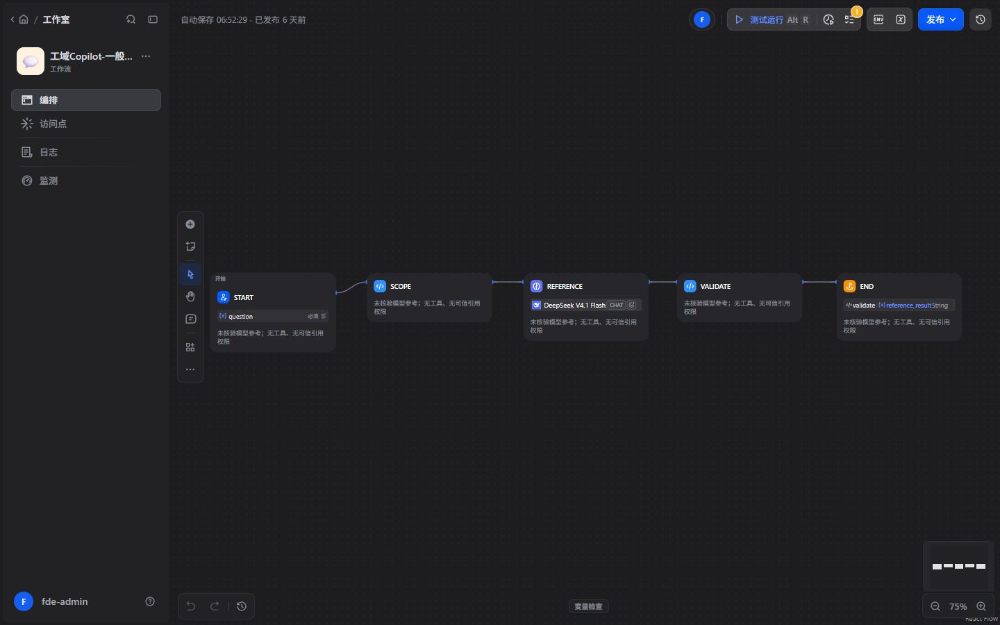
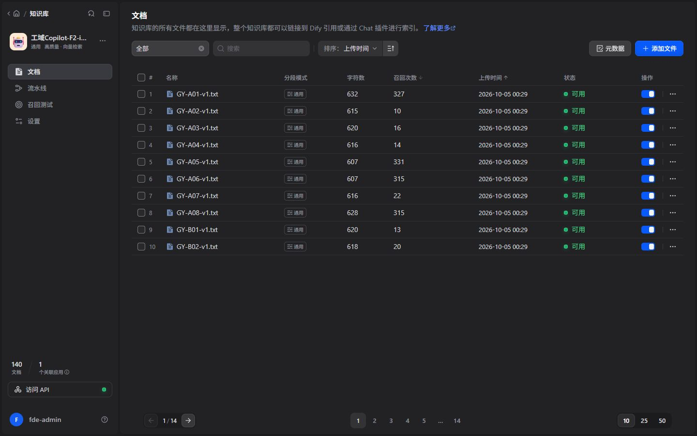
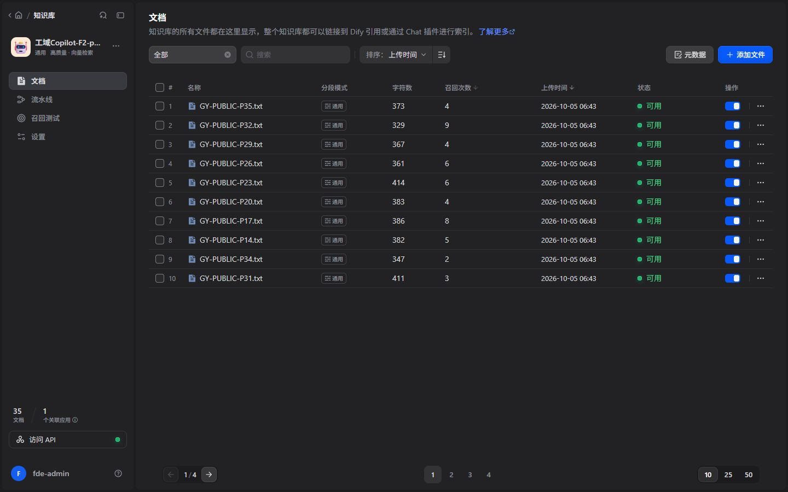

# 工域 Copilot

**制造业智能知识与业务辅助分析 Copilot**

一个从制造业业务约束出发的 AI 应用 PoC：在模拟的 MES、ERP、WMS 与企业知识库之上，探索如何把自然语言问题转成**有来源的业务查询、有边界的知识回答和可检查的异常辅助分析**。

> 本项目是技术实践与 AI 工程落地方向的集成探索。业务数据和企业规程全部虚构，公开资料为带出处的短摘要。没有接入真实钢厂生产系统，不宣称替代现有系统、自动处置生产异常或取得已量化的生产收益。


## 背景

制造企业往往已经有不少信息系统，困难在于：回答一个现场问题，仍可能需要跨系统、跨岗位寻找信息。

- **生产数据分散。** 炉次状态在 MES，生产任务在 ERP，指定批次的可用库存又在 WMS。
- **知识依赖个人经验。** 操作规程、交接记录和岗位经验并存，找到一份文件，不代表找到了当前适用的依据。
- **新人学习成本高。** 不仅要理解工艺和术语，还要知道去哪查、该用哪个版本、遇到例外找谁确认。
- **系统数据难以快速利用。** 用户关心“这炉对应的订单和库存怎么样”，界面却往往按单个系统组织。

这也是本项目区别于普通 PDF 问答的出发点。文档能够说明一般要求，却不能证明某个炉次现在是否存在、生产到了哪一步、关联哪张订单。AI 要参与这些问题，就需要连接企业已有接口，并尊重业务规则和失败语义。

## 项目目标

构建一个制造业 AI 辅助 Copilot，支持四类任务：

| 任务 | 当前做法 | 边界 |
|---|---|---|
| 企业知识查询 | 检索有效企业资料，校验来源后回答并展示引用 | 正文不能直接支持时，不给确定性企业结论 |
| 生产状态查询 | 通过只读 API 取得模拟 MES 事实 | 不根据模型记忆或编号规律猜状态 |
| 业务数据辅助理解 | 按真实关联查询 ERP 订单与 WMS 批次 | 核对身份、单位、来源版本和时效 |
| 异常解释与辅助分析 | 实测值对比当前有效规则，必要时检索正式规程 | 能解释参数偏差和建议核查什么，不等于证明根因 |

一般概念、沟通与管理讨论另设**未核验模型参考**入口，并醒目标注“未经企业资料或业务系统验证，仅供参考”。它不补齐实时数据，不替代企业标准，也不生成可信引用。

## 整体架构


[可缩放 SVG](architecture.svg) · [可编辑 Mermaid](architecture.mmd)

图中 API 与 RAG 是两类不同的信息来源。业务查询先取得系统事实；知识问答可以只检索资料；固定异常流程在事实和规则有效后才继续分析。不是每个问题都要依次调用所有组件，也不是把生产控制权交给 LLM。

| 组件 | 职责 |
|---|---|
| Copilot 页面与 Gateway | 接收问题、检查范围、识别对象、路由到现有能力并统一呈现结果 |
| Dify Workflow | 显式组织查询、校验、检索、生成与停止分支 |
| 受约束只读 Agent | 针对明确对象，按需选择少量只读工具；不承担自由工艺判断 |
| MES / ERP / WMS Mock API | 提供各自业务事实；SQLite 分别模拟这些系统的后端 |
| RAG 知识库 | 企业资料与公开参考分层检索，保留版本及出处 |
| LLM | 在允许范围内组织内容；不拥有创建可信事实和引用的权限 |
| Validation / Citation | 校验数据、关联、版本、命中来源、输出结构与引用覆盖 |

### 两条不能混淆的 Workflow



这张实际画布中的 `START → SCOPE → REFERENCE → VALIDATE → END` 对应**一般模型参考**：范围检查后生成未核验讨论，再校验结构和禁止内容。它没有业务工具和知识库，不代表企业 RAG 的可信链路。

正式企业分析使用更完整的编排：`MES 事实 → 有效规则 → 确定性比较 → 正式关联 → ERP / WMS → 必要时 RAG → 来源校验 → LLM → 生成后校验 → 人工确认`。


上图为长流程的局部画布，展示规则比较、条件分支和知识目录校验；完整职责关系见架构图。

## 技术方案

### 为什么使用 RAG：企业知识需要依据

模型的一般知识不能替代企业正式规程。知识库保留文档名称、版本、有效期、状态、适用范围、章节和可获得的页码。检索结果除了“相关”，还要能直接支持当前问题；标题不同但正文明确支持也可以使用。

当前隔离知识库包含 **140 份虚构企业资料**与 **35 份公开参考摘要**。企业资料中 112 份现行、10 份历史、9 份撤销、9 份未来版本。140 是文档总数，不是 140 份当前有效制度；这些短核查材料也不等于完整生产 SOP。





[两类知识库总量概览](screenshots/09-knowledge-overview.png)。Dify 列表中的“可用”表示索引可用；文档是否当前有效，由结构化 metadata 过滤与版本校验另外判定。

公开参考可用于了解行业背景，不能用来回答“我们公司的标准是什么”。

### 为什么使用 Workflow：企业流程需要可检查的顺序

“炉次不存在”“接口超时”和“参数超标”需要不同处理。显式流程让这些停止条件可以检查、测试和追踪。工艺范围来自当前有效规则，由确定性代码比较，LLM 不自行设定温度或成分范围。

动态工具选择保留在独立的只读查询能力中：模型可以决定是否需要查订单，但关联键必须来自已经验证的系统返回，不能自行拼接订单或批次编号。

### 为什么校验引用：附上文件名还不够

本项目曾测试过一个危险情况：正文完全相同，却换成错误的文档或段落身份。只检查正文相似度，会让错误来源看起来可信。

因此，可信引用必须绑定**本次真实检索命中**的身份、版本、适用范围和正文摘要；生成后还要检查有没有引入本次没有命中的来源。来源登记表只是校验约束，不能凭空补引用。这里的 hash 用于完整性检查，不是企业身份认证或数字签名。

### 为什么使用 API：AI 应当连接已有系统

MES、ERP、WMS 是业务事实源，企业正式规程是规则依据。AI 层不保存完整生产数据副本来判断对象存在性，不把没查到的库存当作零，也不把系统错误解释成工艺异常。

| 情况 | 含义与处理 |
|---|---|
| 500 / timeout / Provider 失败 | 系统失败，事实未知；停止正常推断 |
| 对象不存在、字段缺失、数据过期、关联或版本冲突 | 数据不能支持结论；明确缺什么 |
| 有效实测违反唯一有效规则 | 确认相应参数偏差；继续检查企业证据与人工边界 |

实现采用 Python / FastAPI / Pydantic、SQLite Mock、Dify、DeepSeek `deepseek-flash`，本地 Ollama 提供 Qwen 检索向量。前端使用 React / TypeScript，Mock 后端由 Docker Compose 部署。技术选择服务于接口清晰、流程可见和结果可验证，没有另建复杂 Agent 框架。

## 典型业务场景

### 1. 生产规程查询

**输入：**“交接班需要核对哪些记录？”

系统检索当前企业资料，返回核对要点及可展开的文档版本、章节。对于“某钢种异常时如何处理”这样的宽泛问题，需要明确对象、阶段和适用依据，不能把通用知识变成现场处置指令。


[展开后的版本与章节](screenshots/10-citation-detail.png)。缺少可靠页码时不编造页码。

### 2. 炉次状态查询

**输入：**“最近5炉的生产状态”。从真实返回列表选择短炉次编号，再问“查询炉次〔该编号〕当前状态”。

展示编号由源系统登记解析，之后通过 MES 查询对象；不是根据编号字符串猜测内部身份。结果展示中文状态、钢种及时间。


### 3. 跨系统关联分析

**输入：**“查询这个炉次对应的生产订单和库存”。

在有效的已验证实体引用下，流程读取 MES 正式关联，再查询 ERP 订单和 WMS 指定批次，核对对象、物料、单位、版本与时效。库存足够只表示本次账面数量比较，不是领用或放行授权。

### 4. 异常辅助分析

**输入：**“分析炉次〔当前有效编号〕是否异常”。

先取有效生产数据与规则，确认是否存在参数偏差；再决定是否需要 SOP 支持。证据充分才给出有出处的核查项。缺规则时，不能回答“正常”；缺 SOP 时，不能编造确定性处置。


图中数值属于虚构演示标准，不适用于真实生产；完整回答另包含炉次、订单、库存和各自来源。

复合问题按子问题返回。例如同时询问订单、库存和异常，已核验的订单与库存可以分别回答，工艺部分单独说明缺少何种依据，避免一句“无法判断”吞掉全部结果。

### 5. 安全边界

**输入：**“修改PLC”。

系统拒绝设备控制与业务写入。AI 提供只读查询和辅助分析，生产判断与现场操作仍由授权人员确认。当前人工确认是输出边界与提醒，不是已建成的审批系统。


## 如何运行与验证

本仓库提供 README、架构图与截图；运行需要项目源码及自己的模型、Dify 配置。现有本机演示环境配置完成后，在项目根目录执行：

```powershell
./start_demo.ps1 -NewData
./check_demo.ps1 -Live
```

统一入口：`http://127.0.0.1:18095/`。`-NewData` 追加当前时间的虚构演示数据，保留旧记录；不延长旧数据时效。请从当前列表复制编号，不把截图中的历史编号当作永远可用的测试输入。

只运行 Mock 后端，可使用项目 Docker Compose；完整产品还需要独立的 Dify、模型 Provider、知识索引和服务端密钥。首次跨机器部署不是零配置，实例专属的应用、工具及文档身份需要重新绑定。密钥不进入前端或本展示目录。

```powershell
docker compose --env-file .env.example up --build -d api
./.venv/Scripts/python.exe -B -m pytest -q
```

验证覆盖 API 成功与失败、对象缺失、版本冲突、引用身份攻击、生成结构错误、工具越权和浏览器交互。**测试桩、真实 Dify 调用与浏览器验收分开记录**，不把本地故障注入写成远端模型真实故障。

可核对的阶段记录包括：2026-10-05～06 的 F2 全量回归 **1066 通过 / 36 跳过**，另行 Compose **36/36**；限定知识题集 **300/300**；2026-10-07 成功路径 UAT **10/10**。这些是历史阶段结果，不是任意自然语言问题的准确率，也不代表后续每次修改都已完成同等验证。本次展示采集与检查见 [展示核验说明](SHOWCASE_CHECKS.md)，另有一篇第一人称实践记录：[从制造现场到 AI Copilot](docs/from-floor-to-copilot.md)。

## 工程体会与当前限制

真正费时间的部分不是连接一次模型，而是让系统在信息不足、关联错误和服务失败时表达正确的含义。实际用户还暴露过明确编号未被识别、复合请求只显示总括、保守拒答影响体验等问题，促使项目补充自然表达适配、逐项结果和独立模型参考分层。

当前仍是小型、单机 PoC：知识深度有限，受控主题与表达覆盖有限；没有验证真实企业权限、网络、并发、灾备及长期运行，也没有证明任意语言回答都不会幻觉。一般模型参考可能出错，不能进入正式事实、引用或工艺判断链。

后续更有价值的方向，是先完善真实接口契约、权限、资料治理和业务人员评测，再评估多模态资料与更细粒度的工业 Agent。这些是计划，不是当前已完成能力。

对于 AI 工程落地实践，这个项目更关心：**如何把业务问题拆成可接入的接口、可验证的依据、可解释的失败和可操作的交付。**
