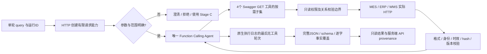

# Stage D：受约束的只读 Agent

Stage D 是独立的 Dify Workflow 应用，包含一个官方 Function Calling Agent 节点。原 Stage C 异常分析图、发布版本、来源门禁、Qwen 知识库和 DeepSeek 生成校验保持冻结。它们分别服务动态业务查询和确定性工艺分析。

## 平台与模型

实际实例使用 Dify 1.17.1。使用官方 `langgenius/agent` 0.0.50 strategy（完整包 identity 保存在 DSL），最低要求 Dify 1.7.0。生成模型仍为 `langgenius/deepseek/deepseek / deepseek-flash`，thinking=false、temperature=0.1、max_tokens=4096。Agent 不调用知识库，也不创建索引；Stage C 继续使用既有 Qwen3-Embedding-0.6B / Ollama / 1024 维正式索引。

接入依据：[官方 Agent 节点说明](https://docs.dify.ai/en/cloud/use-dify/nodes/agent)、[Swagger 工具说明](https://docs.dify.ai/en/cloud/use-dify/workspace/tools)、[官方 strategy 配置源码](https://github.com/langgenius/dify-official-plugins/blob/main/agent-strategies/cot_agent/strategies/function_calling.yaml)。采用当前实例已实际验证的经典 Agent 节点，没有启用文档中另列的 beta 新 Agent。

## 权限与数据流



没有预置 MES/ERP/WMS HTTP 调用顺序的业务节点。模型决定实际工具调用；服务端权限集合和前置依赖约束其可接受路径。缺必需调用、额外调用、猜测对象或不合法顺序均拒绝。关联必须先由真实 MES / ERP 返回，与模型参数完全相等；测试还使用与炉次号无拼接关系的订单和批次键。

## 最小工具集合

窄化契约：`docs/agent_openapi.json`，复用原 `docs/openapi.json` 的业务模型与参数语义。全部只读 GET。

| 工具 | entity_id 来源 | 必须先取得的事实 | 返回含义 |
|---|---|---|---|
| mes_heat | 用户明确 heat_id | 无 | MES 保存的炉次身份、钢种、状态、更新时间；不是工艺判断 |
| mes_links | 同一次请求的 heat_id | mes_heat；且用户需要订单/库存 | 正式订单、物料、批次及最低 ERP/WMS 修订要求 |
| erp_order | 明确用户订单 ID，或已验证 MES link | 炉次入口必须已有 link | 生产订单及指定物料需求；不反推 MES 状态 |
| wms_batch | 明确用户批次 ID，或已验证 ERP batch_id | 联合入口已有 ERP，炉次入口还需 MES link | 指定批次可用量、单位、预留订单及仓位；不存在不能补零 |

不暴露其他 API、Workflow-as-tool、任意 URL/SQL、文件系统、设备控制或单据写入。涉及异常、合格性、工艺范围或 SOP 的请求，明确返回 `USE_STAGE_C_WORKFLOW`。未提供对象、多个对象、订单入口要求反向 MES 状态等情况返回 `CLARIFICATION_REQUIRED`；本轮没有复制异常分析逻辑。

输入语法是有限的显式 ID 提取：支持“炉次/炉号/heat_id”“ERP订单/订单号/production_order_id”“WMS批次/batch_id”或“100235号炉”一类表达。ID 为 1–128 位 ASCII 字母、数字、点、下划线和连字符；不枚举合法业务对象。未知但格式有效的 ID 必须查源系统。未覆盖的自由表达可能要求澄清，不宣称通用中文实体理解。

## 确定性关系与来源

- 炉次入口先查 MES。ERP 的订单、钢种、目标炉次成员、物料、批次必须与 MES link 一致；WMS 的订单/物料/批次、ERP 需求单位和 available 状态必须一致。
- ERP/WMS revision 不得低于 MES 的明确最低要求。跨请求 envelope、数据 hash、字段类型/空值、重复关联成员、身份错误、未来或过期时间均停止。
- 复用 Stage C 的 Pydantic 来源模型、严格 JSON、时间解析、canonical hash 与 provenance 函数。通过新增兼容层完成查询权限校验，不修改冻结的判定或 citation 代码。
- 请求级内存仅保存本次实际响应，最多 100 个短期请求、TTL 300 秒；不是生产数据库或炉次存在性索引。后端固定地址、只允许四条路径、禁止重定向，模型不能提供 URL。
- 查询有效期采用明确的 PoC 保守策略 21600 秒；生成结束前再次检查时间。它不是工艺范围或真实企业 SLA。各源记录不是全局原子快照；真实接入应使用正式 as-of/版本契约。
- 单查仅确认该源对象，不声称验证所有跨系统关系。MES 基础接口无 revision，provenance 明确 null；正式 link、ERP、WMS 保留实际 revision。

## 模型输出与 API provenance

模型唯一终止契约是：

```json
{"selected_claim_ids": ["本次 api_claim_id"], "answer": "对应事实原文以换行连接"}
```

闭合 JSON schema 在 `app.readonly_agent/gateway.py` 的 `OUTPUT_SCHEMA` 中定义：禁止额外字段、最多四条 claim。模型只能选择和重排全部已验证事实句；少项、改数字、加结论、加出处或自动动作均失败。服务端持有真实 facts 和 data_sources，模型没有生成 provenance 权限。`citations=[]`，API provenance 与正式文档 Citation 严格分离。

官方 strategy 的 `text` 会拼接中间调用说明。本实现从其结构化 `json` 日志验证连续的 ROUND 1…6、节点身份、成功状态和最后轮次没有工具响应，取该轮 `llm_response`。不从字符串中找花括号。随后复用冻结的完整 JSON/think/fence 解析及 schema validation，再逐字核对本次 claim 集合和 answer。最终 JSON 非法、think 内伪造 citation 或日志不完整均 fail closed。只向调用者展示 End 的 `query_result`；Agent 思考/日志是未验证调试内容。

每个 capability 由服务端随机生成，四个工具参数均 `auto=0 / variable` 固定绑定；它不进入模型自动参数 schema。仅 entity_id 由模型生成。创建/结束/审计控制接口不在 Swagger 工具表内，并要求本地 `X-Agent-Control` secret。

## 停止条件与错误语义

最多四次业务调用、每类工具只调用一次、单次源 HTTP timeout 5 秒、Agent 最多六轮，不重试。超过预算、重复、缺前置依赖或越权后，该请求关闭；失败后的再次调用不能访问业务系统。

| 情况 | 最终语义 |
|---|---|
| 验证成功且输出覆盖通过 | verified_read_only / VERIFIED_API_QUERY |
| 源 404 对象不存在 | data_error / OBJECT_NOT_FOUND；停止，不能判工艺异常 |
| 源 409 空值/缺关联/数据无效 | data_error，保留稳定原因码；不补事实 |
| 源 422 或权限/参数不完整 | request_error / INVALID_PARAMETER 或澄清/权限码 |
| 源 5xx、鉴权失败、timeout、非法响应协议 | system_error；事实状态未知 |
| 身份、最低版本、时效或完整性冲突 | data_error；停止联合结论 |
| Provider、Agent 或输出解析失败 | system_error；无正常业务结果 |
| 工艺分析请求 | request_error / USE_STAGE_C_WORKFLOW |

工具 HTTP 200 可能承载 `request_error/data_error/system_error`，必须检查 body.status；它不是源业务成功。适配层 409 表示无效请求能力，参数路由 422 沿用原 API 错误对象。失败最终清空 facts、data_sources、citations 和 automatic_actions；已取得的原始事实仍可在受保护审计日志检查。

防提示注入采用封闭字段/工具/事实输出及来源文本保留标记检查；已测试恶意工具文本。没有声称识别任意自然语言恶意意图。SHA-256 是完整性检查，不是签名；PoC 信任模拟后端与 Dify 管理环境，不提供生产级身份认证/恶意管理员防御。

## 启动与导入

```powershell
.\.venv\Scripts\python.exe -B audit_artifacts/stage_d_setup.py secret
$env:API_PORT='18090'
docker compose --env-file .env.stage-d -p fde-stage-d -f docker-compose.yml -f docker-compose.stage_d.yml up --build -d api
docker compose --env-file .env.stage-d -p fde-stage-d -f docker-compose.yml -f docker-compose.stage_d.yml --profile test run --build --rm e2e
```

Windows build 使用仅含 ASCII 字符的本地路径 junction（指向本仓库）。`.env.stage-d` 是忽略的本地控制凭证文件，不导出。每次运行明确设置 API_PORT，环境变量会覆盖 env-file；Stage C 仍是 18089。默认 FastAPI 入口和原 OpenAPI 未改；Stage D 使用 `app.readonly_agent.main:app`，额外路由不写入原 OpenAPI。

当前无密钥配置为 `workflows/readonly_agent.stage_d.yml`，实际 Dify 原生导出为 `workflows/readonly_agent.stage_d.export.yml`。当前版本原生导出 dependencies 为空；它不会自动携带 Swagger provider 或 Agent strategy，不能宣称跨实例零配置导入。生成配置显式记录官方 strategy identity；其他实例仍需安装该 strategy、创建四个 Swagger 工具、替换 provider ID/后端地址，并在 Dify secret 环境变量填本地控制凭证。DeepSeek key 沿用 Provider，不在 DSL 中。没有复杂多轮记忆，对象切换必须明确提供新的 ID。验证资产、当前应用与发布 ID 见 `audit_artifacts/STAGE_D_VALIDATION.md`。
