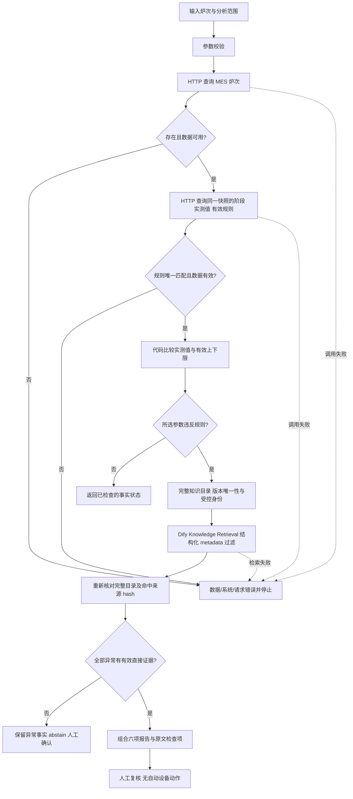

# 任务包 06：异常分析闭环

本轮支持 `heat_id` + `analysis_request`（`temperature`、`chemistry`、`all`）的有限范围分析。自由文本请求不直接变成规则或设备指令；未支持的范围返回参数错误。所有规则与规程均为完全虚构教学材料，不适用于真实生产。

## 显式流程



主要文件：

- `app/analysis/mes_context.py`：新增只读 `/api/mes/heats/{heat_id}/analysis-context`。先查对象存在性，在一个 SQLite 只读事务中读取炉次、阶段、温度、成分和当前有效规则，不执行工艺比较。
- `app/sql/mes_analysis.sql`：MES 后端增加阶段上下文与受控规则表；没有 AI 生产数据库。
- `assets/analysis_demo/rule.json` 与 `documents/`：正式虚构目标标准和检查规程；数据有效期也在标准中明示，不由 LLM 发明。
- `app/analysis/workflow_nodes.py`：可嵌入 Dify Code 节点的标准库函数，进行错误分类、确定性比较、有限范围证据检查和报告组合。
- `app/analysis/export_workflow.py`、`workflows/heat_analysis.yml`：Dify 1.17.1 的显式 Workflow DSL（以 JSON 形式序列化，兼容 YAML）；没有 Agent 或自由生成设备动作的 LLM 节点。
- `app/analysis/run_demo.py`：使用真实 HTTP 查询的本地参考执行器。命令行证据选项是显式测试夹具，不冒充真实知识检索。

## 事实与规则

MES 快照含 `status、steel_grade、process_stage、scope、stage_started_at` 以及真实存储的实测参数。规则只在钢种、阶段、产线、状态及服务端当前时刻均匹配时返回。没有规则、多个有效规则、记录缺失均停止，不使用默认阈值。

实测值与规则字段必须完整、有限、单位一致。阶段开始前、未来或超过规则有效年龄的记录属于数据异常。两次查询间炉次状态发生变化则 `SNAPSHOT_CHANGED` 并停止，提示重新查询。范围上下边界包含在内；不把“未发现所选参数异常”描述成整炉质量合格。

原有五个查询接口保留。新接口返回 404 `OBJECT_NOT_FOUND`，409 `PROCESS_CONTEXT_MISSING / RULE_NOT_FOUND / RULE_CONFLICT / MISSING_FIELDS / INVALID_DATA / MEASUREMENT_MISSING`，以及既有 422 与 5xx 语义。OpenAPI 已重新导出。

## Evidence First 的实现边界

只有确定性比较确认工艺异常后才进入检索。任务 06 将任务 05 的审查约束落实到**有限的预审查检查项映射**：产线、钢种、阶段、规则 ID、异常字段及方向必须匹配；命中必须与受控登记绑定 dataset/document/segment ID、实际文件名、结构化版本/有效期/状态/范围和完整正文 SHA-256。Citation 只从验证后的真实命中产生；每一个异常都要有证据。检索前后核对完整知识目录，当前有效版本不唯一、缺字段、来源未知或目录不完整均停止。

检查项来自 `knowledge_manifest.json` 的预审查条目，且必须是正文中的原句。标题不同可以接受；仅相近主题、部分片段、旧版、未来版、缺少出处或仅覆盖一部分异常都不能输出检查项。检索分数不决定是否放行。

本轮使用原文摘录组合报告，不需要 LLM 生成建议，因此不会凭模型知识补全处置。它不是能理解任意规程/自由文本问题的通用语义审查器；新增规程必须补充受控映射与测试，不能让模型自行声明“已人工审查”。不实现向量库或 Agent Framework。

## 结果契约

| status | 含义 | 后续检索/建议 |
| --- | --- | --- |
| request_error | 参数或分析范围非法 | 不调用 MES |
| data_error | 源系统确认对象不存在、数据不可用或规则缺失/冲突 | 停止，不作工艺推断 |
| system_error | timeout、500、鉴权失败、网络或检索失败 | 停止，不解释为工艺异常 |
| no_anomaly | 本次所选参数均在当前有效规则内 | 不检索、不生成建议 |
| abstain | 已确认工艺异常，但规程证据不足 | 保留异常事实，检查项为空，请人工确认 |
| review_required | 异常事实有有效规程支持 | 返回原文检查项及出处，等待人工复核 |

六项输出对应：`anomaly_facts`（异常事实）、`data_used`（使用的数据）、`business_rules`（对应规则）、`suggested_checks`（建议检查项）、`sources`（文档出处）、`human_confirmation`（人工提醒）。`automatic_actions` 永远为空数组。`trace` 提供执行分支记录。

检索失败发生在异常确认之后时，`status=system_error`，但 `process_anomaly_confirmed=true` 与已确认的异常事实仍保留；系统失败不抹除已获得事实，也不产生建议。对象查询失败时该字段为 null，不能猜测炉次是否异常。

## 本地演示

在仓库根目录执行（项目虚拟环境已有依赖）：

```powershell
.\.venv\Scripts\python.exe -m app.analysis.seed_demo
.\.venv\Scripts\python.exe -m uvicorn app.main:app --host 0.0.0.0 --port 18086
```

第二个终端：

```powershell
.\.venv\Scripts\python.exe -m app.analysis.run_demo DEMO-NORMAL --base-url http://127.0.0.1:18086
.\.venv\Scripts\python.exe -m app.analysis.run_demo UNKNOWN --base-url http://127.0.0.1:18086
.\.venv\Scripts\python.exe -m app.analysis.run_demo DEMO-HIGH-TEMP --base-url http://127.0.0.1:18086
.\.venv\Scripts\python.exe -m app.analysis.run_demo DEMO-HIGH-TEMP --evidence related --base-url http://127.0.0.1:18086
.\.venv\Scripts\python.exe -m app.analysis.run_demo DEMO-BOTH --evidence failure --base-url http://127.0.0.1:18086
.\.venv\Scripts\python.exe -m pytest -q
```

初始化只增加不存在的演示炉次，不覆盖已有记录或刷新已有时间。样例超过标准中的 6 小时后应返回过期；需要重新演示时，在初始化和启动前设置新的 `MOCK_DATA_DIR` 目录，保留旧数据。不要把日期写死为“永远新鲜”。

## Dify 导入与配置

1. 正式专用数据集为 `553a2ee9-b37e-4d0f-b3de-0251267d2f59`，Qwen3-Embedding-0.6B / Ollama / 1024 维。重新索引 5 份虚构来源（当前温度/成分各 1 份，历史/撤销/未来温度各 1 份）；无旧向量混用。原旗舰 App 保持 `c9ccd056-00db-44fc-a07e-d4f385c07400`，审计 clone 不是最终产品。
2. 使用官方 metadata API 写入结构化字段；原生 Knowledge Retrieval manual AND filter 根据 MES scope、钢种、阶段、规则和快照时间过滤 active/current 文档。代码另行校验整个目录版本唯一性，不能只依赖 top-k 或 Prompt。来源登记见 `assets/analysis_demo/dify_source_registry.json`，只登记规程、不复制生产事实。
3. 导出命令：`python -m app.analysis.export_workflow --dataset-id <正式ID> --source-registry assets/analysis_demo/dify_source_registry.json --base-url http://host.docker.internal:18088`。导出 DSL 的 `KNOWLEDGE_API_KEY` 留空；在 Dify secret 环境变量中人工填写只授权该数据集的知识 API 密钥。重建/更换 Dify 文档或片段后必须重新采集真实 ID/hash，禁止沿用旧登记。
4. 本机目录 HTTP 地址是 Dify Compose 内部 `http://nginx/v1`；其他部署应调整 `build_workflow` 的 `knowledge_api_url`。所有 HTTP 节点关闭失败策略与重试。该阶段使用 `fde-stage-a` 独立 Mock 卷与 18088 端口，原 18086 数据未覆盖。
5. 调试：`heat_id=DEMO-HIGH-TEMP, analysis_request=all`。trace 应依次出现 MES HTTP、compare、catalog_http/catalog_check、retrieval、catalog_recheck、evidence。未知炉次不得执行 context/retrieval；正常参数不得进入知识目录或 retrieval。
6. `analysis_result` 是 JSON 字符串。Citation 中实际文件名为 document_name，受控中文标题为 display_name（来自 metadata.controlled_document_name）；正式 Markdown page=null，不假造页码。涉及生产处置仍只提供预审查原文检查项与人工确认提醒，不调用 LLM/PLC。

阶段 A 复现实验脚本为 `audit_artifacts/stage_a_dify.py`：`smoke` 会在原旗舰草稿中临时修改虚构规程 metadata/故障节点并恢复，运行前确保 Docker、Ollama、18088 Mock 与本机凭证可用。只对本机专用演示实例执行，不能对真实企业系统执行。
DSL 结构参照现有 Dify 1.17.1 源码；HTTP 的输出和失败分支设计依据 [Dify HTTP Request 文档](https://docs.dify.ai/en/cloud/use-dify/nodes/http-request)。导入、真实运行情况应以本项目实际联调记录为准，不以生成 DSL 代替端到端验证。

### Dify 1.17.1 的 HTTP 失败边界

该版本 fail-branch/default-value 会丢弃 HTTP 错误响应正文。为保留业务 404/409 与系统 5xx，HTTP 节点不配置失败策略且关闭重试；这些 HTTP 状态进入正常连接边，再由 Code 分类。实际连接失败/超时则 Workflow 标为 failed，没有成功 End 输出。调用方必须将 `workflow_finished.data` 交给 `app.analysis.dify_result.normalize_finished`：无有效输出统一为 system_error / WORKFLOW_EXECUTION_FAILED；调用 Dify 本身超时也同样处理。调试界面显示运行失败时，不可当作炉次不存在或无异常。该约束有本地源码依据和真实断连验证，见 ADR-011。

现场复现与已验证结果见 [DIFY_LIVE_VALIDATION.md](DIFY_LIVE_VALIDATION.md)。仓库两个 `heat_analysis*.yml` 是正式本机受控知识库的无密钥导出；换环境必须重建真实 ID/hash 登记并重新生成。

## 验收场景

| 输入/故障 | 预期 |
| --- | --- |
| UNKNOWN | 一次炉次查询后 data_error；无工艺推断 |
| DEMO-NORMAL | no_anomaly；不检索 |
| DEMO-HIGH-TEMP | 温度异常 + 温度规程检查项 + 出处 |
| DEMO-HIGH-CARBON | 碳异常 + 成分规程检查项 + 出处 |
| DEMO-BOTH | 两类异常都必须有证据，缺一则整体 abstain |
| DEMO-MISSING | 字段缺失 data_error |
| DEMO-NO-RULE | 有炉次但无匹配规则 data_error |
| DEMO-STALE | 已过期数据 data_error |
| 规则冲突/阶段不符/规则过期 | 停止工艺推断 |
| 401/403/500/timeout/无效响应 | system_error，不认定对象不存在 |
| 检索无结果/主题相近/截断正文/失效版本 | abstain，检查项为空 |
| 检索服务失败 | system_error，保留已确认异常事实，无建议 |

演示值只是教学标准。严禁把 `review_required` 视为生产执行授权，人工复核是输出边界，不是自动审批。

## Stage B 当前正式生成分支（2026-09-30）

上文保留 Stage A 的确定性流程。当前旗舰使用 `workflows/heat_analysis.stage_b.yml`：仅 evidence=review_required 才进入 generation_prepare → DeepSeek → generation_validate，证据不足不调用模型。原 MES/目录/检索/来源节点不变。

DeepSeek 只组织允许的事实和原文检查句；生成后的完整 JSON/schema、当前请求引用 metadata/hash、正文支持范围均独立校验。通过才附加 generation；失败停止且无建议/可信引用。既有六项字段、人机边界和 HTTP 错误策略保留。具体契约见 [GENERATION_CONTRACT.md](GENERATION_CONTRACT.md)，实跑见 [Stage B](../audit_artifacts/STAGE_B_VALIDATION.md)。
