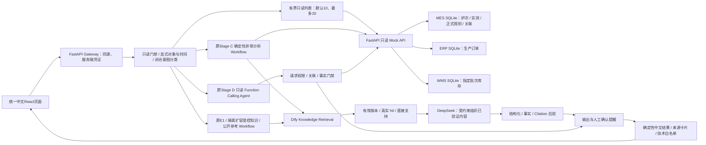
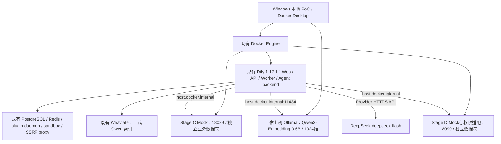
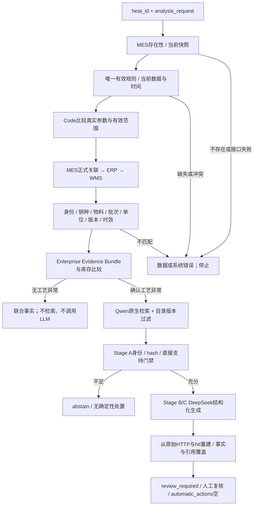
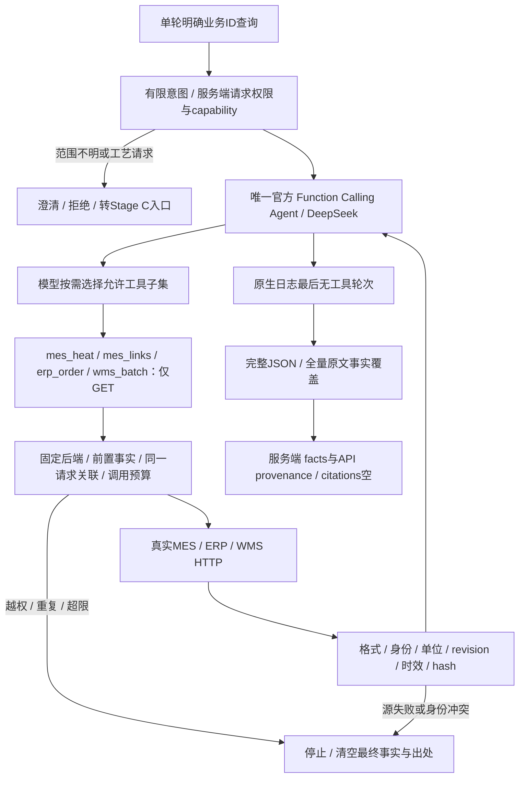
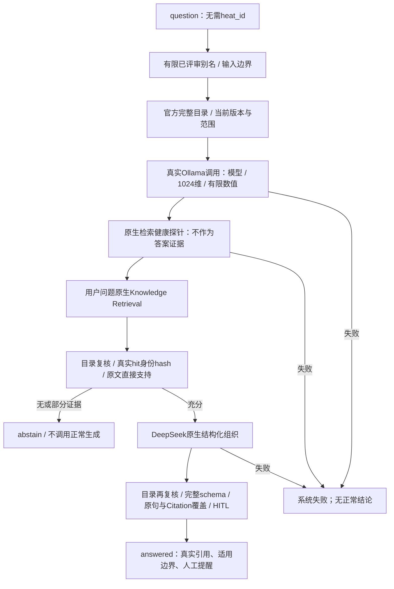
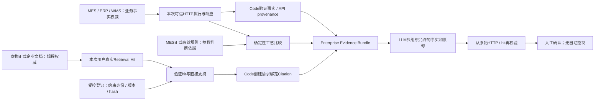
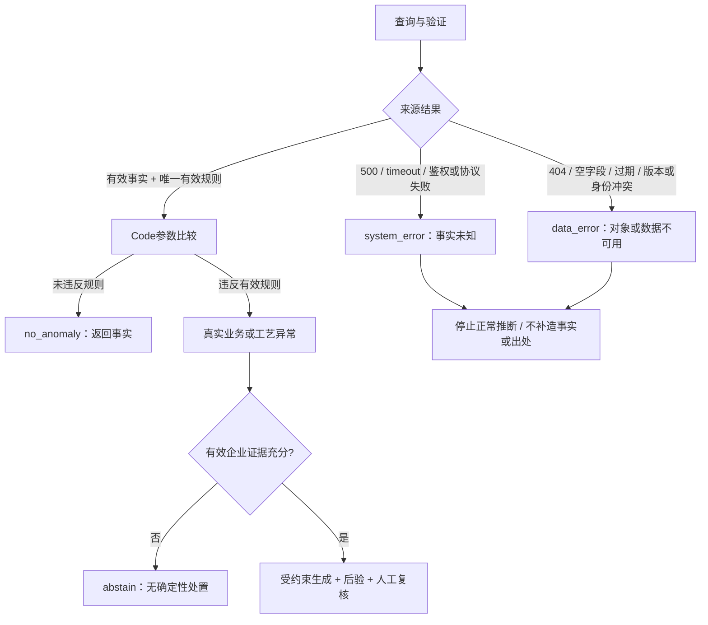

# 最终技术架构

本项目是**基于虚构制造业数据的企业AI集成、可信检索与跨系统分析PoC**。当前统一中文入口为工域 Copilot，Dify作为内部能力后台；生成模型deepseek-flash，Embedding为本地Ollama Qwen3-Embedding-0.6B / 1024维，Dify1.17.1。原C/D/E1核心保持冻结，F2技术验证已完成、等待用户UAT，实际证据见[Stage F2记录](../audit_artifacts/STAGE_F2_ASTRA_VALIDATION.md)，历史F/E2记录保留。

原C/D/E1业务源码、Schema与DSL保持冻结；F2仅新增兼容适配层、隔离知识资产与工作流。FastAPI模拟企业只读接口；MES/ERP/WMS各自SQLite是被模拟系统的数据后端，不是AI生产数据副本。Dify原生PostgreSQL、Redis、sandbox等既有依赖与本项目业务技术栈分开，不新增队列或基础设施。

## 整体架构：一个用户入口

此前已渲染SVG是E2历史架构，当前入口关系以此图为准。

Stage F新增`app/copilot`作为兼容层，不把工艺比较交给自由Agent。六类意图为企业知识、公开行业知识、实时查询、异常分析、澄清和不支持；规则优先，只有未确定问题才调用无回答权限的结构化分类Workflow。分类结果不能创建实体或事实。

明确对象实时查询仍调用原D；异常分析仍调用原C；有限时间列表直接读取Mock后端新详情表，不增加D的工具白名单。短期追问只携带服务端签发的5分钟对象引用，每次重新查询；没有模型记忆或生产事实副本。

## 扩容知识与来源分层

F2新增隔离内部140份原创虚构资料（112现行、10历史、9撤销、9未来，14领域）和公开35份简短改述，分别真实导入与索引。原F的33/4份资料和原5文档知识库保留。生成正文→登记与hash→真实Dify文档/段落身份→结构化metadata→Qwen1024索引→原生检索→来源绑定→原文支持→DeepSeek→后验。完整知识题与桌面体验验收尚未结束。

扩容兼容层在独立命名空间复用E1和A/B校验；检索前后的完整目录、唯一现行版本、正文hash、scope、source_type、URL等保持绑定。公共资料不能作为公司制度，历史/未来/撤销版本不能支持现行结论。page没有可靠信息保持空。健康探针始终不能补用户问题证据。

F2桌面兼容层位于`app/copilot/workspace.py`；前端调用`/api/workspace/*`，原`/api/copilot/*`契约保留。展示短编号由各模拟源系统登记并通过只读接口解析，不能用来绕过MES存在性查询；原始身份及返回出处保留在技术详情。单系统列表不核验跨系统关系，完整对象查询和异常分析仍分别经过D/C门禁。状态面板显示真实服务探针的检查时间，不能据此判断某炉次正常。

新演示详情表位于MES/ERP/WMS模拟源数据库，固定seed与显式as-of生成；它们属于Mock系统。列表中的历史待复核标记是源字段，不是LLM或Gateway对当前工艺作出的判断。

## 模型与平台部署

[已渲染SVG](../assets/diagrams/02-deployment.svg)

## Stage C确定性异常分析

[已渲染SVG](../assets/diagrams/03-stage-c.svg)

## Stage D动态只读工具调用

[已渲染SVG](../assets/diagrams/04-stage-d.svg)

## Stage E1有限知识问答

[已渲染SVG](../assets/diagrams/05-stage-e1.svg)

## 事实、Evidence Bundle、API provenance与Citation

[已渲染SVG](../assets/diagrams/06-trust.svg)

## 三类异常与停止分支

[已渲染SVG](../assets/diagrams/07-errors.svg)

## 可信边界与适用范围

- 企业事实由实际只读HTTP取得；对象存在性以MES查询为准，不枚举合法炉次。参数范围来自MES的唯一有效规则，与实测值分离，Code比较而非模型设阈值。
- 文档Citation只能来自本次已验证用户hit：dataset/document/segment、版本、日期、范围、章节/page、正文hash保持一致。Registry只是约束，不能补Citation；健康canary不能补用户证据。
- API provenance由可信执行与Code产生，保留operation、endpoint、entity、request、revision、时间和hash，不转为文档Citation。SHA-256用于完整性，并非来源签名；PoC信任本机后端和Dify管理环境。
- 有充分证据后才生成；schema合法仍须检查原句、事实、引用和适用条件。LLM输出不授予来源权威。确定性500/timeout、模型/协议失败与证据不足分别处理；无成功End的Workflow按系统失败。
- Stage D最多4次业务调用、每工具一次、6轮Agent、5秒源timeout；关系必须来自已验证上游返回。同一请求能力短期保存响应，不是业务数据副本。
- E1的QA_ALIASES/qa_plan是有限人工评审映射，拒绝未评审表达和缺条件的开放问题。没有通用自然语言蕴含证明。
- 生产建议需人工确认，automatic_actions=[]。没有审批系统、设备控制、生产鉴权、多轮记忆或原子跨系统快照。

固定工艺分析优先Workflow，显式顺序和停止条件可检查；Agent只承担用户明确对象的按需只读查询，不替代工艺判断。两者不预设性能优劣，实际历史比较见[AGENT_VS_WORKFLOW](AGENT_VS_WORKFLOW.md)。
