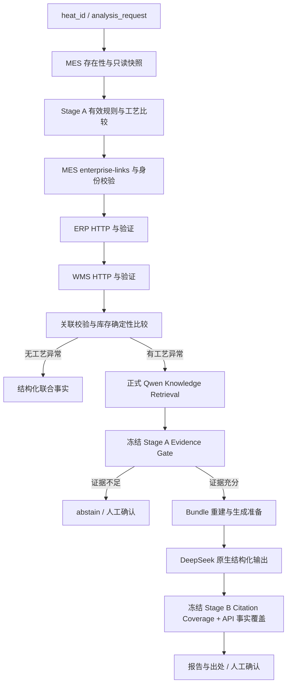

# Stage C：MES + ERP + WMS + RAG

本阶段在冻结的 Stage A/B 来源门禁与生成校验外增加只读企业事实联合链路。所有数据与规程均为虚构教学样例；不连接真实企业系统，不写订单、库存或设备。

## 三个新增接口

所有成功响应均为 `{request_id, data, content_sha256}`，`data` 为对应 Pydantic 模型；hash 使用 UTF-8、键排序、紧凑分隔符、不转义中文的规范 JSON。`X-Request-ID` 绑定本次调用（Dify 使用 `sys.workflow_run_id`），缺省由服务端生成 UUID。模型拒绝额外字段。

| GET 路径 | 模型 / 主要字段 | 用途 |
|---|---|---|
| `/api/mes/heats/{heat_id}/enterprise-links` | HeatTaskLink：heat_id、production_order_id、steel_grade、material_code、batch_id、expected_erp_revision、expected_wms_revision、revision、source_updated_at | MES 正式关联；先查询炉次存在性，不能猜测订单与批次 |
| `/api/erp/production-orders/{production_order_id}` | ProductionOrder：关联 heat_ids、steel_grade、planned_quantity、completed_quantity、quantity_unit、due_date、status、material_code、batch_id、required_quantity、material_unit、revision、source_updated_at | 指定生产任务及指定物料需求，不含财务/采购 |
| `/api/wms/batches/{batch_id}` | InventoryBatch：batch_id、material_code、material_name、production_order_id、available_quantity、unit、warehouse、location、status、revision、source_updated_at | 指定任务批次的可用库存，无自动扣减 |

源系统成功查询但无对象为 404/data；炉次存在但缺正式关联为 409/data/UNVERIFIED_CROSS_SYSTEM_RELATION；源字段无效为 409/data/INVALID_DATA；非法参数为 422/request；访问故障按已有 500/502/503/504 系统错误处理。查询不到批次不能补零。全部错误沿用 API_CONTRACT，不把 HTTP 失败解释成生产异常。

## 确定性身份与版本

MES 关联决定查询参数。ERP 的订单、钢种、heat_ids 成员关系、物料和批次必须匹配；WMS 的订单、物料、批次必须一致，单位必须与 ERP 指定需求一致，状态必须 available。源 revision 不得低于 MES 正式关联指定的最低版本。Workflow 不依据 ID 拼接规律、文字相似性或模型推断关系。

本 PoC 以 MES 快照时间为基准，复用当前规则中明确的 `max_age_seconds`（演示规则为 6 小时）检查各源 `source_updated_at`，未来/过期记录均停止。这是保守的教学假设：真实 ERP 订单可能长期未修改但仍有效，生产接入必须换成各系统正式的 as-of / revision / 有效性契约，不能照搬此年龄策略。

## Enterprise Evidence Bundle

机器可读定义：`assets/enterprise_demo/bundle.schema.json`。包含 request_id、heat_id、mes/erp/wms（verified、entity_id、facts、provenance）、rag.verified_hits、integrity_sha256。未验证事实为空对象，关联未取得时 entity_id 可空；MES task_link 未取得时明确 null。

`data_sources` 由 Code 输出，是独立 API provenance：system、operation_id、endpoint、entity_id、request_id、revision、source_updated_at、content_sha256、response_body_sha256。MES 有 context 与 link 两次来源，ERP/WMS 各一次。冻结的 context 没有 revision，明确 null。文档 citations 仍只来自 Stage A 验证后的真实 hits；API 数据不转成知识库 citation。

生成前和生成后都从本次原始 HTTP 输出重新构建 bundle，检查请求、身份、版本、正文与事实 hash，不能只重算 bundle hash 就通过。SHA-256 是完整性检查，不是来源签名：本 PoC 信任只读后端及 Dify 执行环境，未实现对恶意后端或管理员篡改全部原始输出的认证防御。

## Workflow



任何参数、MES、有效规则或跨系统验证失败均提前停止。原生 HTTP 不重试、不设置丢弃错误正文的失败策略。能取得结构化错误时，返回已确认事实、missing_sources 与 partial_evidence / critical_failure，停止正常联合生成；真实连接超时无 End 输出时由调用边界归一为 system_error，不能承诺保留未成功输出的中间事实。当前不在 ERP/WMS 缺失时继续调用模型生成降级报告。

## DeepSeek 权限与输出

模型契约：`assets/enterprise_demo/generation.schema.json`，最外层仅 `mes_report` 和 `enterprise_summary`。mes_report 完全复用 Stage B schema（request identity、claims、citations、answer 等）；逐字复制经验证的 MES 内容。enterprise_summary 仅允许重排四条由 API 事实预先确定的 claim_id/text。模型没有 data_sources 或 bundle 的生成权限。

Code 使用冻结的完整 JSON / think / Markdown 解析、schema、finish reason、reasoning citation 与覆盖校验；再检查 API claim 集合和文本完全一致。API 事实句内出现 `[cite:` 保留标记时，在进入模型前 abstain；生成后重新构建事实句时再次检查，避免源文本反射成文档引用。新增/遗漏/改数值/伪造来源均拒绝。最终 Code 追加 `enterprise_generation`（schema_version、request_id、facts_summary、answer），保留原 generation，另带 bundle、data_sources、inventory_assessment、missing_sources。`automatic_actions=[]`，生产建议必须人工确认。

## 启动与演示

本地使用独立演示目录：设置 MOCK_DATA_DIR 后执行 `python -m app.enterprise.seed_demo`，再启动已有 FastAPI。初始化只 INSERT OR IGNORE，不刷新旧记录时间；超过教学有效期时新建独立虚构演示目录/卷，不能把陈旧事实静默改成实时事实。

本机已使用独立 `fde-stage-c` Mock 卷与端口 18089：

```powershell
$env:API_PORT='18089'
docker compose -p fde-stage-c -f docker-compose.yml -f docker-compose.stage_c.yml --profile test build
docker compose -p fde-stage-c -f docker-compose.yml -f docker-compose.stage_c.yml up -d api
docker compose -p fde-stage-c -f docker-compose.yml -f docker-compose.stage_c.yml --profile test run --rm e2e
```

Windows 本机 Docker build 仍使用指向本仓库、仅含 ASCII 字符的本地路径 junction。Dify 需运行，Local Ollama 需加载既有 Qwen embedding；Provider / 数据集 secret 在 Dify 中配置。当前导入 `workflows/heat_analysis.stage_c.yml`，不导入冻结的旧 DSL 回退旗舰。

| 输入 heat_id（analysis_request=all） | 预期 |
|---|---|
| DEMO-HIGH-TEMP | 温度异常 + 正式 SOP + ERP/WMS 联合报告 |
| DEMO-BOTH | 温度与成分异常 + 多文档来源 |
| DEMO-NORMAL | 联合结构化事实；不检索、不调用模型 |
| DEMO-SHORTAGE / DEMO-ZERO | 有 SOP 的异常报告；库存比较分别不足 / 零库存，不自动领料 |
| UNKNOWN / DEMO-MISSING | 对象不存在 / 数据缺失；停止后续推断 |

关系来自每次 MES API，不来自此演示表。正式草稿、发布版本及故障注入证据见 `audit_artifacts/STAGE_C_VALIDATION.md`。该链路不是开放式问答、Agent 或真实企业生产集成。
