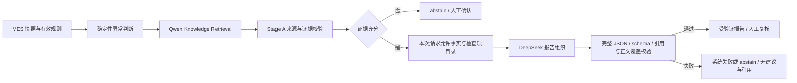

# Stage B：受约束生成契约

2026-09-30。适用于原旗舰异常分析 Workflow；不是开放式知识问答或通用语义审查。阶段 A 的来源验证、metadata、版本与 Qwen 索引实现保持冻结。

## 流程与职责

DeepSeek `deepseek-flash` 只在 `review_required` 且证据完整时调用。它可以调整事实、检查项列表内部的顺序，不能新增或改写句子、范围、规则、引用或人工提醒。这样能机械验证回答没有越过证据支持范围；不宣称自动判断任意自由文本的语义蕴含。已有六项业务报告保留，成功时附加 `generation`。

## 结构

模型输出的唯一契约见 [generation.schema.json](../assets/analysis_demo/generation.schema.json)。所有字段必填，所有对象 `additionalProperties=false`，无类型转换：

| 字段 | 类型 / 来源 |
| --- | --- |
| answer | string；事实句、带引用标记的检查句、人工提醒按列表顺序换行连接 |
| analysis_summary | array of `{claim_id, text}`；全部来自本次 MES 异常事实与有效规则 |
| check_recommendations | array of `{check_id, text, citation_ids}`；全部来自 Stage A 预审查原文检查项 |
| citations | array；每项含 citation_id、dataset_id、document_id、segment_id、document_name、version、effective_date、scope、chapter、section、page、content_sha256 |
| human_confirmation | string；原报告人工提醒，不得删改 |

`page` 为正整数或 null；正式 Markdown 演示来源为 null。SHA-256 必须是 64 位小写十六进制。数组和字符串长度受 schema 限制。

校验通过后由 Code 添加 `schema_version=1.0`、`model=deepseek-flash`、`request_id`，最终附加对象契约见 [generation.result.schema.json](../assets/analysis_demo/generation.result.schema.json)。`request_id` 来自 Dify `sys.workflow_run_id`，不是模型参数。没有请求 ID 必须拒绝生成。

## `<think>`、包装与失败语义

生产配置：thinking=false、reasoning_format=separated、response_format=json_object、Dify 原生 structured_output 开启、8192 max_tokens、temperature=0.1、无重试、LLM fail-branch。原生能力用于提高成功率，不能代替本项目校验。依据：[Dify LLM 节点](https://docs.dify.ai/en/cloud/use-dify/nodes/llm)、[DeepSeek JSON Mode](https://api-docs.deepseek.com/guides/json_mode/)。

解析只识别一个完整的前置 `<think>...</think>`，以及包住整个 JSON 的完整 Markdown fence，然后对剩余全文严格 `json.loads`。不寻找首尾大括号，不修复非法或截断 JSON。重复 key、NaN/Infinity、多个对象、前后自然语言、未闭合标签均拒绝。若 Dify 同时提供 text 和 structured_output，两者必须通过独立 schema 校验并完全一致。finish_reason 非 stop/tool_calls 即停止，即使文本恰好是完整 JSON。

reasoning 不进入最终答案；其中具体的伪造 citation 标记也会拒绝。仅私有 reasoning 中的字面格式模板 `citation_id`、`...`、`<citation_id>`、`<id>` 不当作真实来源；这些模板不能进入最终引用字段。

Dify 1.17.1 强制开启 thinking 时曾把 reasoning 的 JSON 片段解析成 structured_output；本项目独立 schema/channel 校验拒绝该输出。生产关闭 thinking，仍保留同样防线。Provider 参数校验真实失败也进入显式系统失败分支。

| 错误 | 结果 |
| --- | --- |
| 缺少可信来源、来源变化、无请求身份 | abstain；无可信引用/检查项 |
| 引用越权、metadata/hash 改写、缺失/重复引用、正文越界/不一致 | abstain；无可信引用/检查项 |
| schema、JSON、原生/text 不一致、截断 | system_error；无生成对象、引用/检查项 |
| Provider 节点异常 | system_error / LLM_PROVIDER_FAILURE |
| Workflow 无有效 End 输出、MES timeout | 既有 normalize_finished 返回 system_error / WORKFLOW_EXECUTION_FAILED |

失败可保留此前已经确认的 MES 事实，但绝不把生成失败认定为新的工艺异常。所有路径 automatic_actions=[]。

## Citation Coverage

1. 从 Stage A 验证结果与**实际原生命中**交叉绑定来源 ID、全文与 hash、版本/章节/page/scope，建立本次目录，不查询 manifest 补引用。
2. citation ID 由 workflow_run_id、heat_id、分析范围、快照及完整来源身份生成；即使同炉次同快照，新请求也不同。claim/check ID 同样绑定请求。
3. 模型回传的引用必须恰好覆盖本次允许集合，每个来源字段完全一致。真实但未命中的文档、旧版本、其他请求引用同样拒绝。
4. 每个事实与检查项必须与允许目录逐字一致，所有项均须保留。answer 必须由这些项机械重建；有正确 citation 但新增结论依然拒绝。
5. 最终 citation 从可信目录复制，不采用模型回传的对象。最终保留人工确认，没有 PLC/设备执行动作。

实现：[generation_nodes.py](../app/analysis/generation_nodes.py)、[generation_workflow.py](../app/analysis/generation_workflow.py)。导出为 [heat_analysis.stage_b.yml](../workflows/heat_analysis.stage_b.yml)；旧 Stage A DSL 保留作冻结基线。本机正式 App 和数据集沿用 Stage A，无密钥导出不能直接提供 Provider 凭证或知识目录 API 密钥；在 Dify 管理界面配置已有 Provider，并填 secret 环境变量后发布。

完整实测与边界见 [STAGE_B_VALIDATION.md](../audit_artifacts/STAGE_B_VALIDATION.md)。
