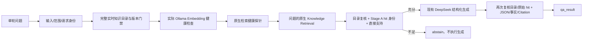

# Stage E1：独立在线企业知识问答

这是独立、单轮、有限范围的 Dify Workflow，无需 heat_id。正式入口与发布版本见 [本轮验证](../audit_artifacts/STAGE_E1_VALIDATION.md)。它复用现有 Qwen 知识库、Stage A 来源验证函数和 Stage B 严格 JSON/schema 工具；没有改写 Stage C 异常分析或 Stage D 四工具 Agent。

## 能回答什么

知识库是完全虚构的 DEMO-LINE-A / DEMO-A / review 复核资料。支持温度偏差人工核查、成分偏差人工核查、两者组合，以及相应复核员的人工确认职责。偏差须先由有效 DEMO-RULE-A-REVIEW-v1 确认；问答只解释规程，不能证明任何实际炉次异常。

可演示输入：

- “温度偏差时规程要求检查什么？”
- “温度不对劲，规程让我们核对啥？”
- “成分偏差时规程要求检查什么？”
- “温度和成分偏差时规程分别要求检查什么？”
- “现行规程对相关岗位的职责有什么要求？”

这是有限、人工评审的问题别名与原文支持表，定义在 `app/knowledge_qa/nodes.py` 的 QA_ALIASES / qa_plan；不是通用中文蕴含判断。未覆盖表达应 abstain，可人工补充评审后再扩展，不能由模型自行扩大回答范围。

现有资料没有规定转炉终点温度处置、记录缺失时的专门流程、设备调节参数、其他钢种或其他岗位职责。因此“转炉终点温度异常时检查什么？”、“生产温度记录缺失时核查什么？”以及“检查什么并如何调设备？”不会被现有类似文字替代回答。完整问题只有部分支持时，说明覆盖不足并整体 abstain。

## 实际结构

模型 `deepseek-flash`，thinking=false、temperature=0.1、json_object、原生 structured_output、reasoning separated。Embedding 为现有 `qwen3-embedding:0.6b` / Ollama，实测 1024 维；现有 Weaviate 不变。不增加 Agent、Reranker、向量数据库、会话记忆或业务 API。

Dify 1.17.1 在本轮本机 Ollama 停止测试中返回过空检索数组，不能仅把原生空 result 当作服务健康。因此 E1 增加真实模型调用、模型名/维度/有限数值校验和独立已知语料检索探针。探针用于判断检索可用性，**绝不能填补用户问题的 evidence 或 citation**。用户检索为空、但健康检查通过时才是 NO_EVIDENCE；探针/模型失败为系统失败。保留原生节点失败分支。HTTP transport 导致无成功 End 时，调用方必须把失败 Workflow 归类系统失败，不能当作企业资料不存在或返回模型原文。

原生配置依据：[Knowledge Retrieval](https://docs.dify.ai/en/cloud/use-dify/nodes/knowledge-retrieval)、[LLM](https://docs.dify.ai/en/cloud/use-dify/nodes/llm)；同时核对实际安装的 1.17.1 节点源码。健康门禁是对此次观察到的失败语义缺口的本应用适配，不修改平台源码。

## Evidence First 与 Citation

1. 通过正式知识 API 读取完整目录；分页不完整或服务失败不继续。active、当前有效期、scope/钢种/阶段、结构化字段和受控登记必须一致；完整目录检查避免 top-k 隐藏有效版本冲突。
2. 原生检索使用 manual AND metadata filter：active、DEMO-LINE-A、DEMO-A、review、有效期、version/identity/hash/章节非空；不靠 Prompt 选最新版。
3. 每个用户 retrieval hit 都调用冻结 `verify_controlled_hit`，校验 dataset/document/segment ID、实际文件名、版本、有效日期、scope、章节、page、正文 SHA-256；任一混入错误来源或重复片段均停止。page=null，不造页码。
4. 评审原文必须存在于本次真实命中正文，覆盖整个问题；相似度和标题不能代替直接支持。所有目录来源变化、旧/撤销/未来片段、冲突或不完整条件均 fail closed。
5. 引用从验证后的用户 hit 产生，绑定本次 workflow_run_id；登记表只提供身份约束及评审映射，不能补引用。探针、未命中文档和模型输出不具有来源权限。
6. 生成后再次重建允许的句子和 Citation，比较每个 claim/引用及全部 metadata/hash、适用条件、人工提醒和完整正文。合法 JSON 本身不足以通过验证。

## 输出与失败

生成 schema 保存为 `assets/knowledge_qa/generation.schema.json`：answer、supported_points、citations、applicability、human_confirmation，均为必需字段，禁止额外字段。DeepSeek 只能保留原文、引用和条件；最终来源由 Code 从 hit 复制。严格完整 JSON 解析、native/text 一致性与 schema 校验复用 Stage B，不截取花括号、不删除非法字段、不修补模型 JSON。

正常 `qa_result` 为 answered / VERIFIED_KNOWLEDGE_ANSWER，可展示问题回答、逐条规程依据、文档/版本/章节来源、适用边界和人工提醒。citations 保存真实身份和 hash；automatic_actions 永远为空。这里没有 MES 实时事实或 API provenance。

证据不足/来源越权为 abstain，answer 与 citations 为空，并给出原因。输入诱导、未知问题、仅部分支持均不进入正常生成；Provider、Embedding、检索、协议/JSON/截断失败为 system_error，绝不返回未验证模型原文。Private reasoning 不显示，出现伪引用仍拒绝。

## 启动、重启与迁移

1. 启动 Docker Desktop，确认 Engine 和既有 Dify API/Postgres/plugin daemon/Weaviate/sandbox 健康；保留所有卷。若出现已记录的 Windows socket 问题，只处理经核对的运行时目录，不能重置 Docker 或删除数据卷。
2. 启动本机 Ollama：`ollama serve`，设置 OLLAMA_HOST=127.0.0.1:11434 与 OLLAMA_MODELS 指向本机模型目录。Dify 中原 Provider 地址和模型配置保持不变。
3. 检查 `/api/ps`，用 `/api/embed` 对 qwen3-embedding:0.6b 预热；确认一条向量1024维。冷加载及本轮时延见验证报告，不做生产性能承诺。
4. 确认正式数据集5文档/5片段索引完成、有效metadata可用，并检查现有 DeepSeek Provider。E1 不需要启动 MES Mock 才能问知识；18091独立 Mock 卷仅用于本轮旧API/Agent部署回归。
5. 打开 E1 应用运行页；输入上述支持问题和拒答问题。调用发布 API 使用独立本地 E1 key，未导出到仓库文件。

现有实例无密钥配置 `workflows/knowledge_qa.stage_e1.yml`，原生实际导出 `knowledge_qa.stage_e1.export.yml`。跨实例须绑定实际既有模型、正式知识库、真实来源登记和 Dify secret KNOWLEDGE_API_KEY；不能把当前 document/segment ID、旧向量或本机运行记录当作其他实例已验证。工具脚本 install/publish 只操作新 E1 App。

本轮不做开放知识应用、任意问题语义审查、生产级并发、独立审批系统或 Stage E2。真实测试、故障注入层级和仍未验证的边界见 [STAGE_E1_VALIDATION](../audit_artifacts/STAGE_E1_VALIDATION.md)。
