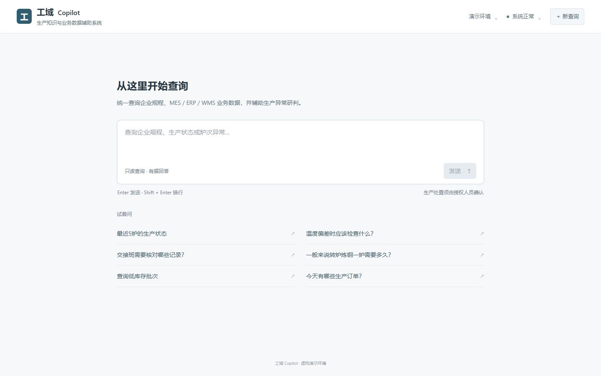
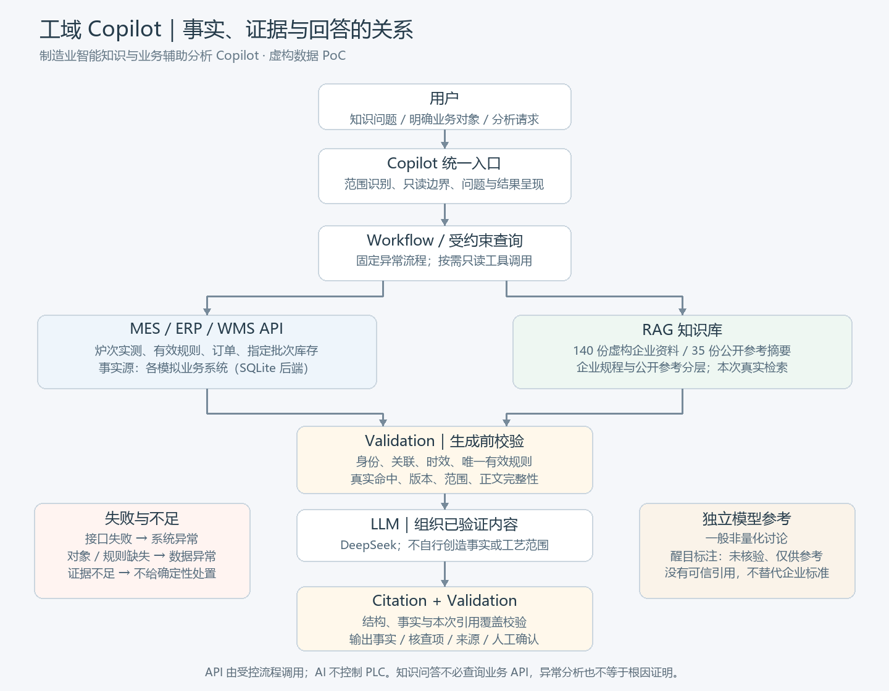
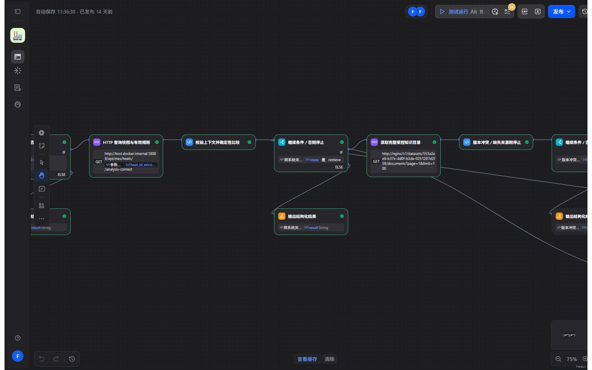
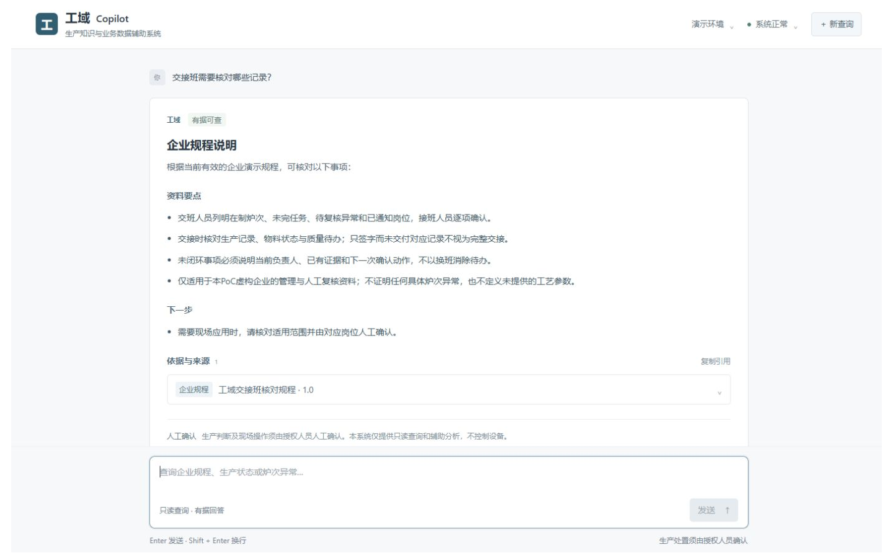
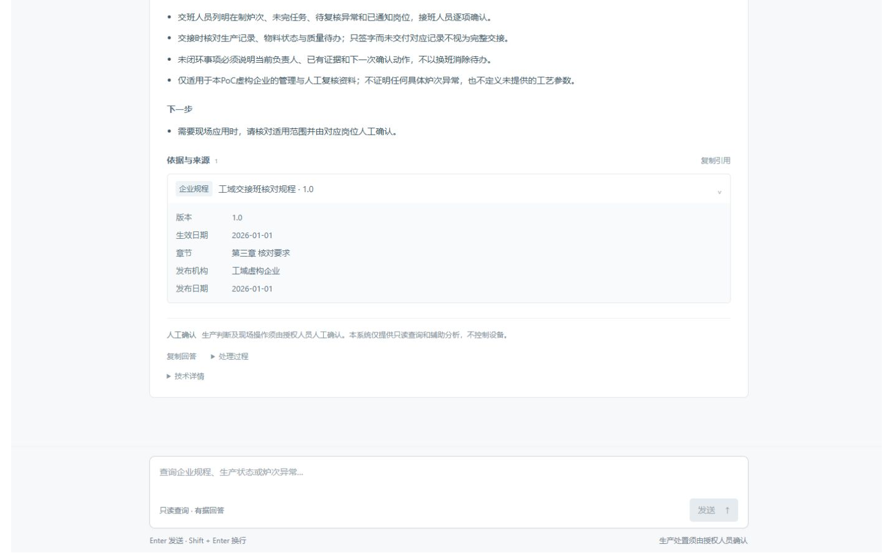
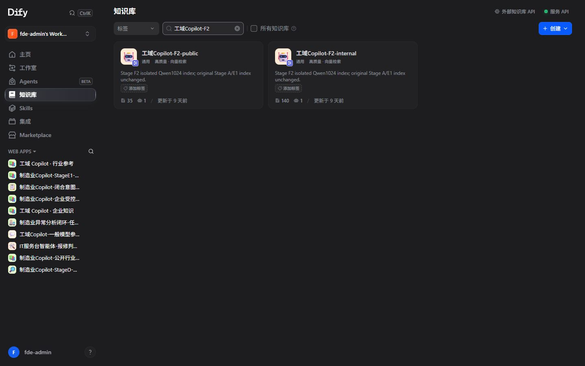
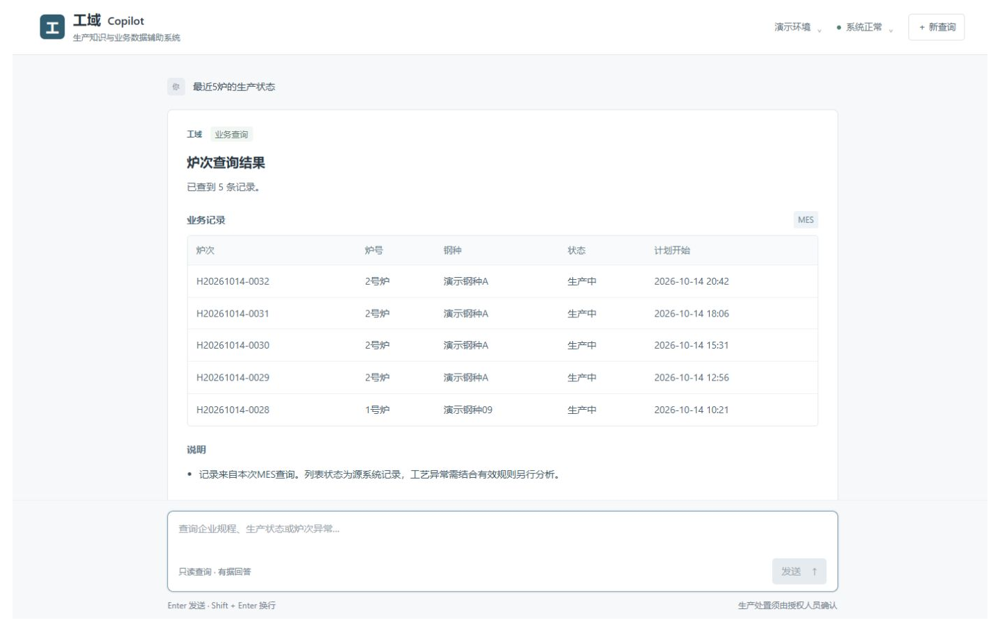
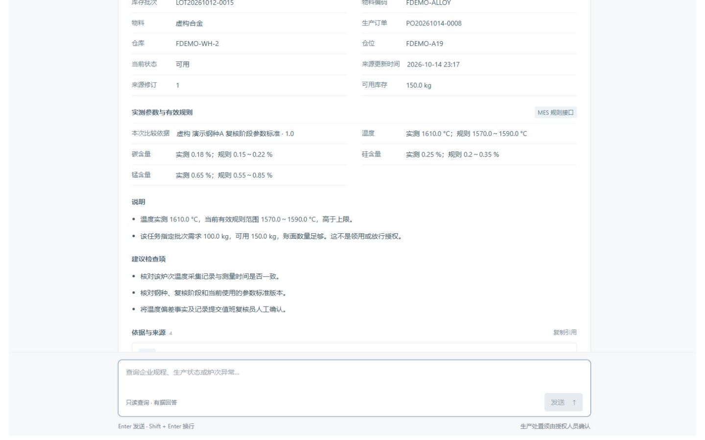
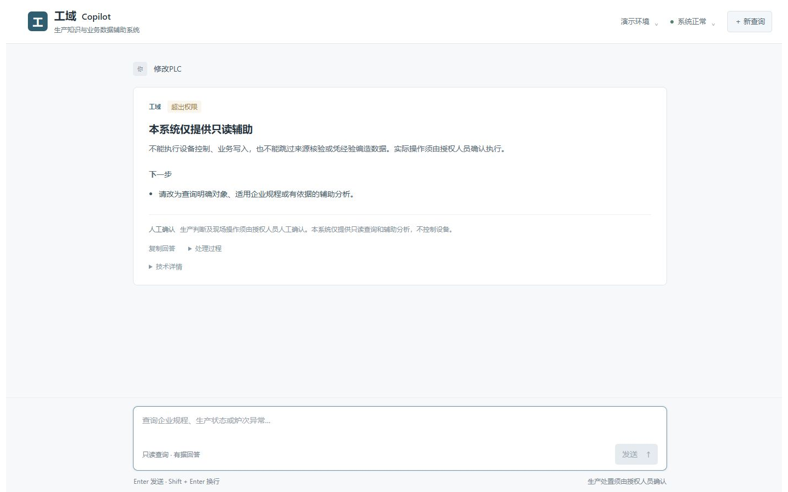

# 从制造现场到 AI Copilot：我做了一次有边界的实践

在制造业里，回答一个问题，有时比找到一个数据更麻烦。

炉次状态在 MES，生产任务在 ERP，库存批次在 WMS；操作规程在文档库里，特殊情况还要找熟悉业务的人确认。系统都有，信息也有，但要回答“这炉现在怎么样”，仍然可能需要在几个系统之间来回查找。

带着制造业数字化的工作视角，作为一个技术爱好者，我尝试做了 **工域 Copilot（制造业智能知识与业务辅助分析 Copilot）**：用自然语言，把业务查询、知识资料与辅助分析连接起来。

先说明：**这是一个 PoC，生产数据与企业规程全部虚构。** 它没有接入真实钢厂，也不是要替代生产系统。我的目标是验证一条有业务边界、能实际跑通的企业 AI 应用链路。

*图1｜统一入口。用户从问题出发，系统再判断应该查询业务数据、检索资料，还是提示补充条件。*

## 一、我想解决的，不只是“和文档聊天”

制造企业的知识，既在系统里，也在文件里，还在人的经验里。

对熟悉现场的人来说，知道“去哪查”“该信哪个版本”“遇到例外找谁确认”，往往是长期积累的经验。新人不仅要学习术语和工艺，还要学习这些查找路径。

AI 可以帮助缩短这段路径。但仅仅把 PDF 放进知识库，并不能回答某个炉次现在是否存在、关联哪张订单、库存是否可用。反过来，只查到几个数值，也不能直接得出工艺结论。

所以我把问题分成三类：**规程怎么说、系统有什么事实、这些事实能支持什么判断。** 这三件事需要不同的依据。

## 二、让 AI 接在原有系统之上

我用 FastAPI 和 SQLite 模拟 MES、ERP、WMS 的后端，用 Dify 编排查询、检索与生成流程，再提供一个统一页面。

这里的 SQLite 属于模拟业务系统，不是 AI 为了回答问题另建的生产数据库。对象是否存在、状态是什么，仍由相应接口返回。

*图2｜API 提供业务事实，知识库提供资料依据。生成前后都要校验，模型负责组织允许使用的内容。此图为架构示意。*

几项技术选择，都来自具体约束。

**用 RAG，是因为企业知识需要出处。** 模型的一般知识不能替代企业正式规程，检索到的资料也必须适用当前问题。

**用 Workflow，是因为步骤有先后依赖。** 炉次不存在，就停止；规则缺失，就不能判断正常与否。不能把这些决定全部交给模型自由发挥。

**用 API，是因为数据已经有自己的归属。** MES、ERP、WMS 继续提供事实，AI 增加交互和解释能力。

**校验引用，是因为“附了文件名”还不够。** 引用必须对应本次真实检索命中，版本、适用范围和正文都要对得上，不能由模型编一个看起来可信的来源。

*图3｜实际 Dify 编排中的规则判断和停止分支。长流程分段查看，图中是局部，不是完整流程截图。*

对于业务查询，我也保留了一个受约束的只读 Agent，让它按需选择少量工具。它可以决定要不要查订单，但订单与批次的关联必须来自系统字段。**选择工具的自由，不等于创造事实的自由。**

## 三、场景一：问规程，同时看到依据

我先用一个明确的问题演示：

> 交接班需要核对哪些记录？

系统检索企业演示资料，返回核对事项，并提供可展开的来源。

*图4｜真实页面上的企业知识回答。内容来自虚构演示规程，不是模型自行补充的现场制度。*

*图5｜展开同一次回答的来源，可以查看文档版本、生效日期和章节；没有可靠页码时，不编造页码。*

目前演示库有 **140 份虚构企业资料、35 份公开参考摘要**。企业资料包含历史、撤销和未来版本，用于测试错误版本能否被挡住；140 是总数，不是 140 份当前有效制度。

*图6｜实际知识库概览。企业规程与公开参考分开管理，公开行业资料不能冒充本公司的正式标准。*

我把这种原则称为 Evidence First：**先看有没有足够依据，再决定能回答到哪一步。** 语义相近，并不代表正文真的支持答案。

比如问“我们公司的标准生产时间是多少”，企业资料没有正式标准，就不能拿公开文章中的行业示例来填空。

## 四、场景二：从炉次查到业务记录

> 最近5炉的生产状态。

这类问题需要查 MES，而不是查文档或问模型记忆。

*图7｜实际调用模拟 MES 得到的记录，展示业务短编号、中文状态和本地时间。截图编号仅对应采集时的虚构数据。*

从列表选中一个对象后，可以继续查询它对应的生产订单和库存。系统沿 MES 提供的正式关联读取 ERP、WMS，并核对对象、物料、单位、版本和时效。

这里容易忽略几个区别：**没查到批次，不等于库存为零；账面数量足够，不等于允许领用。** 模型把几段话说顺畅，并不能代替这些业务检查。

## 五、场景三：异常分析，先有规则再谈建议

> 分析这个炉次是否异常。

我的处理顺序是：查询炉次 → 获取有效实测数据与规则 → 确定性比较 → 必要时检索正式规程 → 校验证据 → 生成辅助分析。

其中，温度或成分范围来自当前适用的规则，不由模型根据训练知识设定。缺规则时，系统不能回答“正常”；确认了参数偏差但缺少 SOP 时，也不能继续编造确定性的处置方案。

有充分依据时，回答可以列出偏差事实、使用的数据、规则依据、建议核查项和引用来源。但这仍然是**辅助分析，不是已经证明了真实根因**，生产处置需要授权人员确认。

*图8｜同一次实际分析的结果局部：实测值与有效规则分开展示，再给出有依据的核查项。图中温度和范围全部是虚构演示参数，不适用于真实生产。*

设备控制也不在这个 PoC 的权限里。

*图9｜用户要求修改 PLC，系统拒绝执行。只读查询和辅助分析不包含设备控制或业务写入。*

## 六、开发中，比接通模型更难的几件事

**知识质量。** 文档数量增加，不代表答案就更可靠。虚构资料也要处理版本、范围和重复内容；这些演示短文仍不等于可直接用于现场的完整制度库。

**引用真实性。** 我测试过保留正文、替换文档身份或撤销版本的情况。因此校验不能只看文字相似，还要检查本次命中的来源身份与完整性。它提高了可追溯性，但不意味着彻底消除了幻觉。

**接口失败的含义。** timeout 是系统没及时返回，404 是没有查到对象，字段缺失是数据不足；它们都不能直接解释成工艺异常。

**用户的表达习惯。** 实际试用时，编号放在不同位置、一次问几个关联问题，都暴露过体验问题。我做了有限适配，但没有把任意复合问答作为本轮 PoC 的目标。优先跑通典型链路，比宣称什么都能问更实际。

**部署与使用体验。** Docker、模型服务、接口和知识索引需要共同可用。进程存在不代表查询成功；一次成功演示，也不代表具备长期生产可用性。

对于一般概念和非操作性讨论，系统另有醒目标注的“未核验模型参考”。它可以用于启发思考，但不能填补实时数据、企业标准或生产处置依据，也不带企业可信引用。

## 七、我如何验证这个 PoC

我把验证分成接口与门禁自动化、真实 Dify 调用、引用攻击测试，以及浏览器操作。成功路径之外，也测试对象不存在、数据缺失、接口失败、失效版本和越权请求。

已有阶段记录包括 F2 时的 1066 项 pytest 通过、36 项跳过，另行部署测试 36 项通过，以及限定的 300 题知识评估。这些是**对应版本与限定范围的历史结果，不是开放问答准确率，也不是当前版本全量验收声明**。

文章中的页面截图来自实际运行；调用的是模拟企业接口，使用的是虚构数据。架构图用于解释设计，不冒充执行证据。这个项目没有真实生产收益数据，也没有验证企业级并发、权限体系和长期运行。

## 八、下一步，我更想先把基础做好

如果继续探索，我会优先考虑真实接口契约、权限、资料治理和业务人员评测。在这些基础上，再评估多模态资料理解和更细粒度的工业 Agent，而不是先扩大功能清单。

做完这个 PoC，我更关心的问题变成了：**AI 的回答，如何连接到可信的数据、适用的规则和明确的业务责任？**

工域 Copilot 是我作为技术爱好者、沿制造业数字化与 AI 工程落地方向做的一次实践。它不完美，但把一些原本抽象的约束，变成了可以运行、查看和讨论的流程。这是我最希望通过这次探索留下的东西。
